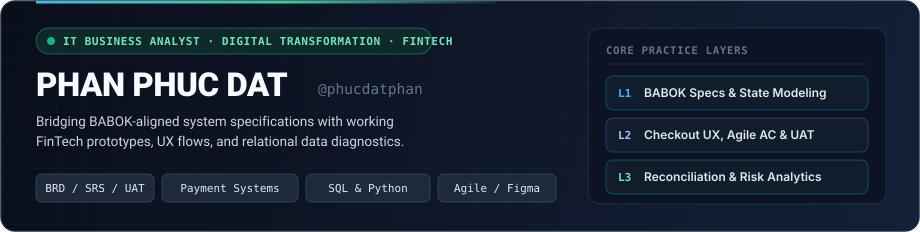
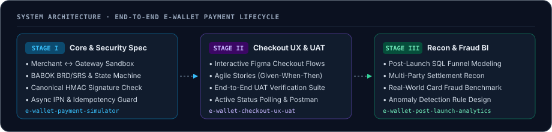
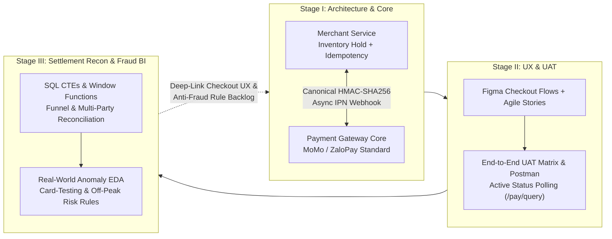

  

 

---

## Executive Summary

I am an **Innovation and Technology** graduate from the **University of Economics Ho Chi Minh City (UEH)** specializing in **IT Business Analysis**, **Digital Transformation**, and **FinTech System Architecture**. Rather than treating business documentation and software engineering as isolated phases, my practice pairs **BABOK-aligned specifications (`BRD`, `SRS`, `User Stories`, `UAT`)** directly with working system prototypes and relational data diagnostics in **Node.js, Python, and SQL**.

Core methodology:
- **Specification-Driven System Design:** Translating complex business domains into unambiguous functional contracts, stakeholder matrices, state transition models, and testable Gherkin (`Given–When–Then`) acceptance criteria.
- **Payment & Distributed Reliability Invariants:** Designing FinTech checkout workflows around strict correctness guarantees—decoupled asynchronous `IPN` webhooks, canonical `HMAC-SHA256` signature verification, timing-safe validation, `Idempotency` anti-replay guards, and inventory reservation locks.
- **Closed-Loop Product & Settlement Analytics:** Applying SQL (`CTEs`, `Window Functions`) and Python pipelines to audit multi-party financial reconciliation flows, diagnose checkout conversion friction, and formulate payment anomaly rules.

---

## Case Study: End-to-End E-Wallet Payment Architecture

  

 

| Stage | Repository | Focus Area | Architectural Scope & Deliverables |
| :--- | :--- | :--- | :--- |
| **Stage I** | [**`e-wallet-payment-simulator`**](https://github.com/phucdatphan/e-wallet-payment-simulator) | Core Payment Engine & Security Spec | Dual Merchant & Gateway Node.js sandbox, BABOK-aligned BRD/SRS, Order Lifecycle State Machine (`DRAFT → PENDING → SUCCESS / FAILED / EXPIRED`), canonical `HMAC-SHA256` verification, `Idempotency` protection, and inventory reservation holds. |
| **Stage II** | [**`e-wallet-checkout-ux-uat`**](https://github.com/phucdatphan/e-wallet-checkout-ux-uat) | Pre-Launch Checkout UX & UAT Suite | Interactive Figma checkout wireframes, Agile User Stories with Gherkin (`Given–When–Then`) Acceptance Criteria, active status-polling fallback design for network latency, end-to-end UAT test matrix, and automated Postman API collection. |
| **Stage III** | [**`e-wallet-post-launch-analytics`**](https://github.com/phucdatphan/e-wallet-post-launch-analytics) | Post-Launch Funnel, Settlement Recon & Fraud BI | Relational SQL (`CTEs`, `Window Functions`) & Python warehouse modeling checkout conversion funnels, multi-party bank settlement reconciliation (`AMOUNT_MISMATCH`, `MISSING_IPN`), and real-world card payment anomaly / anti-fraud rules. |

<strong>Expand System Dataflow &amp; Closed-Loop Iteration (Mermaid Diagram)</strong>

 

---

## Technical & Business Analysis Stack

| Domain | Methods, Languages & Tooling |
| :--- | :--- |
| **BA & Product Modeling** |         |
| **Backend & Data Engineering** |   -0284C7?style=flat-square&logo=postgresql&logoColor=white)     |
| **API Verification & Dev** |      |
